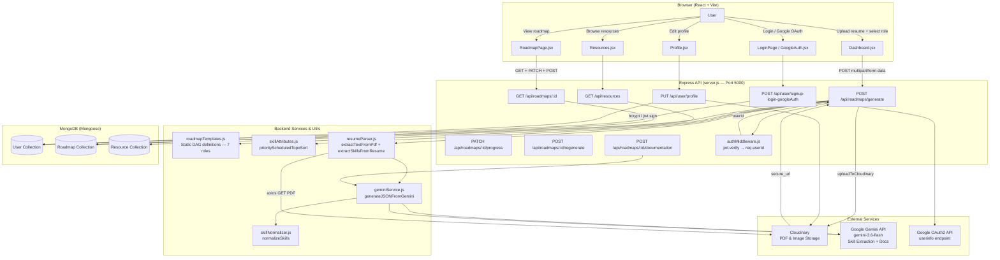
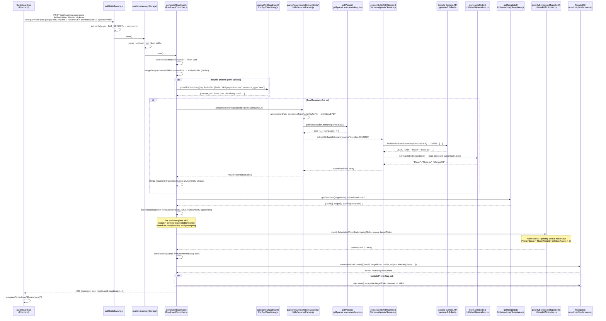

# SkillGraph — Complete Presentation Reference

> **Usage:** This document is your single source of truth before and during the presentation.
> Every claim is sourced from an actual file/function in this repository.
> Use Ctrl+F on a section heading to jump straight to an answer under pressure.

---

## 1. One-Line Pitch & Elevator Summary

**One-line:** SkillGraph is an AI-powered career roadmap generator that reads your resume, identifies your skill gaps, and builds a personalized, dependency-aware learning path using a priority-weighted topological sort.

**Elevator summary:** Most developers don't know *what* to learn next, or in what *order*. SkillGraph solves this by parsing a user's resume with Gemini AI, comparing their extracted skills against curated, role-specific skill dependency graphs (DAGs), and producing a personalized learning roadmap with each skill ranked by job-market demand, difficulty, and how many other skills it unlocks. The result is not just a list — it's a graph, ordered by a real algorithm, showing exactly which skill to learn first and why.

---

## 2. Tech Stack Table

> Source: [`Backend/package.json`](file:///d:/Projects/SkillGraph/Backend/package.json) and [`frontend/package.json`](file:///d:/Projects/SkillGraph/frontend/package.json). Only packages actually listed there are included.

| Layer | Technology | Version / Package | Role |
|---|---|---|---|
| **Frontend** | React | `^19.2.6` | UI component framework |
| **Frontend** | React Router DOM | `^7.15.1` | Client-side routing |
| **Frontend** | Axios | `^1.16.1` | HTTP client for API calls |
| **Frontend** | Tailwind CSS | `^4.3.0` | Utility-first CSS styling |
| **Frontend** | Framer Motion | `^12.40.0` | Animations and transitions |
| **Frontend** | Lucide React | `^1.16.0` | Icon library |
| **Frontend** | React Toastify | `^11.1.0` | Toast notification system |
| **Frontend** | ReactFlow | `^11.11.4` | Interactive DAG graph visualization |
| **Frontend** | @dagrejs/dagre | `^3.1.1` | Auto-layout engine for the ReactFlow DAG |
| **Frontend** | @react-oauth/google | `^0.13.5` | Google OAuth2 login button component |
| **Frontend** | Vite | `^8.0.12` | Build tool and dev server |
| **Backend** | Node.js + Express | `^5.2.1` | REST API server (ESM modules) |
| **Backend** | Mongoose | `^9.6.2` | MongoDB ODM / schema layer |
| **Backend** | Multer | `^2.1.1` | Multipart file upload handling |
| **Backend** | multer-storage-cloudinary | `^4.0.0` | Cloudinary storage adapter for Multer |
| **Backend** | jsonwebtoken | `^9.0.3` | JWT signing and verification |
| **Backend** | bcrypt | `^6.0.0` | Password hashing (cost factor 10) |
| **Backend** | pdf-parse | `1.1.1` | PDF text extraction (CommonJS interop via `createRequire`) |
| **Backend** | axios | `^1.16.1` | HTTP client for Cloudinary PDF download |
| **Backend** | cors | `^2.8.6` | Cross-Origin Resource Sharing middleware |
| **Backend** | dotenv | `^17.4.2` | Environment variable loading |
| **Backend** | dns | `^0.2.2` | DNS server override (`1.1.1.1`, `8.8.8.8`) |
| **Database** | MongoDB (via Mongoose) | Cloud Atlas | Primary data store; 3 collections |
| **Auth** | JWT (`jsonwebtoken`) | 7-day expiry | Stateless auth token in `Authorization: Bearer` header |
| **Auth** | bcrypt | Cost factor 10 | Password hashing for local accounts |
| **Auth** | Google OAuth2 (`google-auth-library`) | `^10.6.2` | Google sign-in using `access_token` flow |
| **File Storage** | Cloudinary | `^1.41.3` | Stores resumes (raw) and profile images (transformed 400×400) |
| **AI / LLM** | Google Gemini (`@google/generative-ai`) | `^0.24.1` | Resume skill extraction + roadmap documentation generation |
| **Deployment** | Vercel | `vercel.json` present | Frontend hosting |
| **Deployment** | (Backend: unspecified) | `nodemon` for dev | Backend self-hosted or Render/Railway |

---

## 3. System Architecture Diagram



---

## 4. Database Models

> Source: [`Backend/Models/`](file:///d:/Projects/SkillGraph/Backend/Models/)

### 4.1 User Model ([`userModel.js`](file:///d:/Projects/SkillGraph/Backend/Models/userModel.js))

**Represents:** A registered user account (local email/password or Google OAuth).

| Field | Type | Constraints | Notes |
|---|---|---|---|
| `name` | String | required | Display name |
| `email` | String | required, unique | Used as login identity |
| `password` | String | default `""` | bcrypt-hashed; empty for Google users |
| `authProvider` | String | enum: `["local","google"]`, default `"local"` | Tracks which auth flow was used |
| `profilePicture` | String | default `""` | Cloudinary URL or Google profile picture URL |
| `targetRole` | String | default `""` | Saved target career role |
| `resumeUrl` | String | default `""` | Cloudinary raw URL of uploaded resume PDF |
| `skills` | `[String]` | default `[]` | Manually added or auto-merged skills |
| `createdAt` | Date | auto (timestamps) | Mongoose auto-timestamp |
| `updatedAt` | Date | auto (timestamps) | Mongoose auto-timestamp |

**Indexes:** Mongoose default `_id` index; unique index on `email`.

---

### 4.2 Roadmap Model ([`roadmapModel.js`](file:///d:/Projects/SkillGraph/Backend/Models/roadmapModel.js))

**Represents:** A single generated skill roadmap belonging to one user for a specific target role. Contains the full graph (nodes + edges), learning step sequence, and optional AI documentation.

**Sub-schema — Node:**

| Field | Type | Notes |
|---|---|---|
| `id` | String | Matches template skill id (e.g. `"react"`, `"nodejs"`) |
| `label` | String | Human-readable skill name (e.g. `"React"`) |
| `type` | String | `"existing"` (user has it) or `"missing"` |
| `level` | Number | Learning layer 1–5 (set in template) |
| `status` | String (enum) | `"locked"` / `"available"` / `"completed"` |
| `description` | String | Short skill description from template |

**Sub-schema — Edge:**

| Field | Type | Notes |
|---|---|---|
| `from` | String | Source skill id |
| `to` | String | Target skill id |
| `relation` | String | Default `"prerequisite"`; also `"uses"`, `"alternative"`, `"supports"` |

**Sub-schema — LearningStep:**

| Field | Type | Notes |
|---|---|---|
| `order` | Number | Priority-sorted position (1 = learn first) |
| `skill` | String | Skill label |
| `reason` | String | Why this skill matters (from template) |
| `estimatedTime` | String | e.g. `"3-4 weeks"` |
| `resources` | `[String]` | **TODO:** not yet populated (see Section 9) |

**Main Roadmap fields:**

| Field | Type | Notes |
|---|---|---|
| `userId` | ObjectId (ref User) | required; ownership FK |
| `title` | String | `"${targetRole} Roadmap"` |
| `targetRole` | String | required |
| `resumeUrl` | String | Cloudinary URL of the resume used |
| `extractedSkills` | `[String]` | All user skills (profile + resume merged) |
| `missingSkills` | `[String]` | Skills the user still needs |
| `nodes` | `[nodeSchema]` | Full graph node list |
| `edges` | `[edgeSchema]` | Full edge list |
| `learningSteps` | `[learningStepSchema]` | Priority-sorted steps |
| `explanation` | String | Role-specific narrative from `buildExplanation()` |
| `completedNodes` | `[String]` | Node IDs marked done by user |
| `progressPercentage` | Number | 0–100 |
| `isArchived` | Boolean | Soft-delete flag |
| `documentation.content` | Mixed (JSON) | Cached Gemini-generated study guide |
| `documentation.generatedAt` | Date | When cache was last built |

**Indexes:** `{ userId: 1 }`, `{ targetRole: 1 }`, `{ createdAt: -1 }` (explicit via `roadmapSchema.index()`).

---

### 4.3 Resource Model ([`resourceModel.js`](file:///d:/Projects/SkillGraph/Backend/Models/resourceModel.js))

**Represents:** A curated learning resource (video, course, blog, etc.) linked to a skill name.

| Field | Type | Constraints | Notes |
|---|---|---|---|
| `skillName` | String | required, trimmed | Links resource to a skill (e.g. `"React"`) |
| `title` | String | required, trimmed | Resource title |
| `type` | String | enum: `["video","blog","documentation","practice","course","project"]` | Content type |
| `url` | String | required, trimmed | Link to the resource |
| `description` | String | default `""` | Optional description |
| `difficulty` | String | enum: `["beginner","intermediate","advanced"]`, default `"beginner"` | Skill level |
| `tags` | `[String]` | default `[]` | Searchable tags |
| `isFree` | Boolean | default `true` | Free vs. paid flag |
| `source` | String | default `""` | e.g. `"YouTube"`, `"MDN"` |

**Indexes:** `{ skillName: 1 }`, `{ type: 1 }`, `{ difficulty: 1 }`, `{ tags: 1 }`, plus a **full-text search index** on `title + skillName + description + tags` (named `"resource_text_search"`).

---

## 5. Complete Request Flow — Roadmap Generation

> Source: [`RoadmapController.js`](file:///d:/Projects/SkillGraph/Backend/Controllers/RoadmapController.js), [`resumeParser.js`](file:///d:/Projects/SkillGraph/Backend/Utils/resumeParser.js), [`geminiService.js`](file:///d:/Projects/SkillGraph/Backend/Services/geminiService.js), [`skillAttributes.js`](file:///d:/Projects/SkillGraph/Backend/Utils/skillAttributes.js)



---

## 6. The Core Algorithm — Priority-Weighted Topological Sort

> Source: [`Backend/Utils/skillAttributes.js`](file:///d:/Projects/SkillGraph/Backend/Utils/skillAttributes.js)

### What is a DAG in this context?

Each role's skill roadmap is stored as a **Directed Acyclic Graph (DAG)** where:
- **Nodes** = skills (e.g. `"html"`, `"js"`, `"react"`)
- **Directed edges** = prerequisite relationships (e.g. `html → css → js → react`)
- **Acyclic** = no circular dependencies; guaranteed because the templates are manually authored static JSON

The DAG ensures you can't be told to learn React before JavaScript.

### Plain Kahn's Algorithm

Standard Kahn's BFS topological sort:
1. Compute **in-degree** (how many prerequisites each node has)
2. Seed a queue with all nodes that have `in-degree === 0`
3. Repeatedly: pop any node from the queue, add it to the result, decrement the in-degree of its neighbors; if a neighbor's in-degree reaches 0, add it to the queue
4. Repeat until the queue is empty

This gives *a* valid topological ordering, but doesn't say *which* zero-in-degree node to pick first when multiple are available. Plain Kahn's picks arbitrarily.

### How SkillGraph's Priority Scoring Changes the Comparator

At **step 3**, instead of picking any available node, SkillGraph sorts the available frontier by **descending `PriorityScore`** before picking:

```
PriorityScore(skill, edges, targetRole) =
    NodeWeight(skill, targetRole) × (UnlockFactor(skillId, edges) + 1)
```

Where:

```
NodeWeight(skill, targetRole) =
    (1/3 × difficulty) + (1/3 × demandScore) + (1/3 × essentiality[targetRole])
```

- `difficulty` — 0.0–1.0, how hard the skill is (higher = harder = prioritized, since you want to tackle hard things earlier)
- `demandScore` — 0.0–1.0, market demand / job-listing frequency (from template static data)
- `essentiality[targetRole]` — 0.0–1.0, role-specific importance; falls back to 0.5 if role is unmapped

```
UnlockFactor(skillId, edges) =
    count of prerequisite edges where edge.from === skillId
    (restricted to the missing-skill subgraph only)
```

- A high unlock factor means learning this skill now unblocks many other skills quickly
- The `+1` avoids a zero-product when `UnlockFactor === 0`

### Worked Numeric Example — Full Stack Developer Role

Using real data from [`roadmapTemplates.js`](file:///d:/Projects/SkillGraph/Backend/Utils/roadmapTemplates.js), suppose the user has `HTML` already and needs: `CSS`, `Git`, `JavaScript`, `React`, `Node.js`, etc.

Suppose at the initial frontier (zero in-degree within the missing subgraph), `CSS` and `Git` are both available.

**CSS** (missing, from Full Stack template):
- `difficulty = 0.3`, `demandScore = 0.8`, `essentiality["Full Stack Developer"] = 0.9`
- `NodeWeight = (1/3)(0.3) + (1/3)(0.8) + (1/3)(0.9) = 0.1 + 0.267 + 0.3 = 0.667`
- `UnlockFactor` = CSS is a prerequisite to `js` → count = 1
- `PriorityScore = 0.667 × (1 + 1) = 1.334`

**Git** (missing, from Full Stack template):
- `difficulty = 0.3`, `demandScore = 0.9`, `essentiality["Full Stack Developer"] = 0.9`
- `NodeWeight = (1/3)(0.3) + (1/3)(0.9) + (1/3)(0.9) = 0.1 + 0.3 + 0.3 = 0.7`
- `UnlockFactor` = Git is a prerequisite to `deploy` → count = 1
- `PriorityScore = 0.7 × (1 + 1) = 1.4`

**Result:** Git (1.4) > CSS (1.334) → Git is scheduled first. This is sensible: Git unlocks deployment and is essential across all roles; you can learn it in parallel with CSS, and its `demandScore` (0.9) is higher than CSS's (0.8).

### Key Function Signatures

```js
// skillAttributes.js
computeNodeWeight(skill, targetRole)          → Number  // [0,1]
computeUnlockFactor(skillId, edges)            → Number  // integer count
priorityScheduledTopoSort(skills, edges, targetRole) → String[]  // ordered IDs
```

### Complexity

| Version | Time | Space |
|---|---|---|
| Plain Kahn's | O(V + E) | O(V + E) |
| Priority-weighted (this project) | O(V² + E) worst case (sort at each step) | O(V + E) |

In practice V ≤ 12 skills per template, so the overhead is negligible.

### Cycle Safety

Lines 146–149 of `skillAttributes.js` include a safety fallback: if the graph somehow has a cycle (impossible with the static templates), any unprocessed nodes are appended in original order so no skill is silently dropped.

---

## 7. Full API Route Reference

> Sources: [`UserRouter.js`](file:///d:/Projects/SkillGraph/Backend/Routes/UserRouter.js), [`RoadmapRouter.js`](file:///d:/Projects/SkillGraph/Backend/Routes/RoadmapRouter.js), [`ResourceRouter.js`](file:///d:/Projects/SkillGraph/Backend/Routes/ResourceRouter.js)

| Method | Path | Auth Required | Purpose |
|---|---|---|---|
| `POST` | `/api/user/signup` | No | Register new user; hashes password with bcrypt; returns JWT |
| `POST` | `/api/user/login` | No | Login with email + password; verifies bcrypt hash; returns JWT |
| `POST` | `/api/user/googleAuth` | No | Google OAuth2 login; fetches user info from Google userinfo endpoint; upserts user; returns JWT |
| `GET` | `/api/user/profile` | **Yes** | Returns user profile (name, email, role, image, resumeUrl, skills, authProvider) — password excluded |
| `PUT` | `/api/user/profile` | **Yes** | Update name, role, skills, profile image, and/or resume (multipart/form-data); uploads files to Cloudinary |
| `POST` | `/api/roadmaps/generate` | **Yes** | Generate a new roadmap: upload optional resume, run AI extraction, build priority-sorted DAG, save to DB |
| `GET` | `/api/roadmaps/` | **Yes** | List all non-archived roadmaps for the logged-in user, sorted by `createdAt DESC` |
| `GET` | `/api/roadmaps/:id` | **Yes** | Fetch a single roadmap by ID (ownership enforced via `findOne({ _id, userId })`) |
| `PATCH` | `/api/roadmaps/:id/progress` | **Yes** | Update completed nodes; re-derives all node statuses (locked/available/completed) from edges |
| `POST` | `/api/roadmaps/:id/regenerate` | **Yes** | Re-run priority-weighted topo sort on the existing roadmap with current progress; invalidates cached AI docs |
| `POST` | `/api/roadmaps/:id/documentation` | **Yes** | Generate (or return cached) Gemini AI study guide for the roadmap's learning steps |
| `GET` | `/api/resources/` | No | Fetch resources by skill name (`?skill=React`) |
| `GET` | `/api/resources/search` | No | Full-text search across resources (`?q=React hooks`) using MongoDB text index |
| `POST` | `/api/resources/` | **Yes** | Create a new resource entry (admin/developer-only in practice) |

**Auth enforcement:** [`authMiddleware.js`](file:///d:/Projects/SkillGraph/Backend/Middleware/authMiddleware.js) reads `Authorization: Bearer <token>`, calls `jwt.verify(token, process.env.JWT_SECRET)`, and attaches `req.userId = decoded.id`. A missing or invalid token returns `401`.

**Multer:** `/generate` uses `multer({ storage: multer.memoryStorage(), limits: 10MB })` accepting `.pdf/.doc/.docx` only.

---

## 8. Frontend Page / Component Map

> Source: [`frontend/src/App.jsx`](file:///d:/Projects/SkillGraph/frontend/src/App.jsx) and component files

### Routes (from `App.jsx`)

| Route | Component File | What it renders | API calls made |
|---|---|---|---|
| `/` | `Pages/LandingPage.jsx` | Hero, problem, solution, CTA sections | None (public) |
| `/login` | `Pages/LoginPage.jsx` | Email/password login form + Google OAuth button | `POST /api/user/login` |
| `/signup` | `Pages/SignupPage.jsx` | Registration form + Google OAuth button | `POST /api/user/signup` |
| `/dashboard` | `SkillGraph/Dashboard.jsx` | Roadmap generator form (resume + role picker), roadmap history | `GET /api/user/profile`, `POST /api/roadmaps/generate`, `GET /api/roadmaps/` |
| `/roadmap/:roadmapId` | `SkillGraph/RoadmapPage.jsx` | Full roadmap view: Graph/List/Docs tabs, progress tracker, learning steps, sidebar | `GET /api/roadmaps/:id`, `PATCH /api/roadmaps/:id/progress`, `POST /api/roadmaps/:id/regenerate`, `POST /api/roadmaps/:id/documentation` |
| `/resources` | `SkillGraph/Resources.jsx` | Resource search/browse by skill or free-text | `GET /api/resources?skill=`, `GET /api/resources/search?q=` |
| `/profile` | `SkillGraph/Profile.jsx` | View/edit name, role, skills, profile picture, resume | `GET /api/user/profile`, `PUT /api/user/profile` |
| `/about` | `Pages/About.jsx` | About page (static) | None |
| `/guide` | `Pages/Steps.jsx` | How-it-works step guide (static) | None |
| `/policy` | `Pages/PrivacyPolicy.jsx` | Privacy policy (static) | None |
| `/terms` | `Pages/TermsOfServices.jsx` | Terms of service (static) | None |
| `/support` | `Pages/Support.jsx` | Support/contact page | None |
| `/jobtracker/dashboard` | `JobTracker/JobDashboard.jsx` | **Stub only** — renders `<div>JobDashboard</div>` | None |

### Key Shared Components (`frontend/src/Components/`)

| Component | Purpose |
|---|---|
| `Navbar.jsx` | Public navigation (landing, about, etc.) |
| `DashboardNavbar.jsx` | Auth-aware navbar with profile link/logout |
| `RoadmapHistory.jsx` | Card list of past roadmaps; used in Dashboard and potentially RoadmapPage sidebar |
| `GoogleAuth.jsx` | Wraps `@react-oauth/google` `useGoogleLogin` for OAuth2 access-token flow |
| `Footer.jsx` | Site-wide footer with links |
| `HeroSection.jsx`, `ProblemSection.jsx`, `SolutionSection.jsx`, `CTASection.jsx` | Landing page sections |

### SkillGraph Sub-Components (`frontend/src/SkillGraph/components/`)

| Component | Purpose |
|---|---|
| `GraphRoadmap.jsx` | ReactFlow DAG visualization; uses `@dagrejs/dagre` for auto-layout; renders skill nodes with status colors |
| `SkillNode.jsx` | Custom ReactFlow node component (completed/available/locked visual states) |
| `RoadmapDocumentation.jsx` | Fetches and renders Gemini-generated study guide via `POST /api/roadmaps/:id/documentation`; shows cached or freshly generated content |
| `ResourceModal.jsx` | Modal that shows resources for a skill (linked from graph node hover/click) |

### State Management

- **No Redux.** Global state is minimal: `AppContext.jsx` provides only `{ token, setToken, backendUrl }` to the whole tree.
- Token is persisted in `localStorage`.
- All page-level state is local React `useState` / `useEffect`.

---

## 9. What's Complete vs. Pending

> TODOs sourced by grepping the repository. Stubs identified from file inspection.

| Feature | Status | Evidence |
|---|---|---|
| User registration (local email/password) | ✅ Complete | `registerUser()` in `userController.js` — bcrypt + JWT |
| User login (local) | ✅ Complete | `loginUser()` in `userController.js` |
| Google OAuth2 login | ✅ Complete | `googleLogin()` — access_token flow → Google userinfo endpoint |
| JWT auth middleware | ✅ Complete | `authMiddleware.js` — Bearer token, 401 on failure |
| Profile view & edit | ✅ Complete | `getProfile()`, `updateProfile()` with Cloudinary upload |
| Resume upload to Cloudinary | ✅ Complete | Multer + `uploadToCloudinary()` in both profile and roadmap flows |
| PDF text extraction (pdf-parse) | ✅ Complete | `extractTextFromPdf()` in `resumeParser.js` |
| Gemini skill extraction from resume | ✅ Complete | `extractSkillsWithGemini()` → `buildSkillExtractionPrompt()` |
| Skill normalization (alias → canonical) | ✅ Complete | `skillNormalizer.js` — 50+ regex normalization rules |
| 7 role roadmap templates (DAG) | ✅ Complete | `roadmapTemplates.js` — Full Stack, Frontend, Backend, MERN, Software Engineer, Data Analyst, AI/ML |
| Priority-weighted topological sort | ✅ Complete | `priorityScheduledTopoSort()` in `skillAttributes.js` |
| Roadmap generation & save to DB | ✅ Complete | `generateRoadmap()` — full pipeline |
| Node status computation (locked/available/completed) | ✅ Complete | `buildRoadmapFromTemplate()` — prereq-aware status derivation |
| Progress tracking (mark node complete) | ✅ Complete | `updateRoadmapProgress()` — re-derives all statuses from edges |
| Roadmap regeneration (adaptive re-prioritization) | ✅ Complete | `regenerateRoadmap()` — updates existing doc, invalidates AI cache |
| Gemini AI roadmap documentation generation | ✅ Complete | `generateDocumentation()` — caching logic with explicit invalidation |
| ReactFlow DAG visualization | ✅ Complete | `GraphRoadmap.jsx` + `SkillNode.jsx` + dagre auto-layout |
| List view (level-grid) visualization | ✅ Complete | `RoadmapPage.jsx` list mode |
| AI Docs view tab | ✅ Complete | `RoadmapDocumentation.jsx` — shows cached or fetches fresh |
| Resource listing by skill | ✅ Complete | `getResourcesBySkill()` in `ResourceController.js` |
| Resource full-text search | ✅ Complete | `searchResources()` — MongoDB text index |
| Roadmap history panel | ✅ Complete | `RoadmapHistory.jsx` component |
| **`resources` field in `learningSteps`** | ⚠️ **Stub/TODO** | Line 80, `RoadmapController.js`: `resources: [], // TODO: populate with curated resource links` — array is always empty |
| **Job Tracker** | ⚠️ **Stub** | `JobDashboard.jsx` is 9 lines: `return <div>JobDashboard</div>` — no functionality |
| No automated tests | ⚠️ **Gap** | No test files found; `package.json` scripts have only `echo "Error: no test specified"` |
| No rate limiting / abuse protection | ⚠️ **Gap** | No `express-rate-limit` or similar in `package.json` or `server.js` |

---

## 10. Likely Presentation Questions & Answers

---

### 🧮 Algorithm / DSA Questions

**Q1: Why Kahn's algorithm (BFS-based) and not DFS-based topological sort?**

Kahn's is iterative and makes the "available frontier" explicit at every step — this is exactly what we need to inject our priority comparator. DFS-based topo sort produces a valid ordering, but all decisions happen implicitly in the call stack, making it much harder to influence which node is chosen next among equally-valid candidates. Kahn's lets us sort the frontier by `PriorityScore` before each pick.

**Q2: What's the time complexity of the priority-weighted version vs. plain Kahn's?**

Plain Kahn's is O(V + E). Our version adds a sort at each step over the available frontier. In the worst case (a wide DAG where many nodes become available simultaneously), this is O(V log V) per step over V steps = O(V² log V). In practice, our templates have V ≤ 12 skills and sparse edges, so the difference is negligible — the bottleneck is the Gemini API call, not the sort.

**Q3: How do you guarantee the graph stays acyclic?**

All seven DAG templates are statically authored JSON in `roadmapTemplates.js`. No edges are generated dynamically. If a developer accidentally introduces a cycle (which can't happen with the current template structure), the safety fallback in `skillAttributes.js` (lines 146–149) detects unreached nodes after the main loop and appends them in original order, so no skill is silently lost.

**Q4: What happens if two skills have the same priority score?**

JavaScript's `Array.prototype.sort` is stable in all modern engines. Skills with equal `PriorityScore` maintain their original relative order from the template (which is level-ordered, 1→5). So the tiebreaker is effectively the template's defined level order.

**Q5: What does `UnlockFactor + 1` accomplish in the priority formula?**

If a skill is a leaf (no outgoing prerequisite edges), its `UnlockFactor = 0`, making its `PriorityScore = NodeWeight × 0 = 0` with no `+1`. That would collapse all leaf skills to zero priority, ignoring their `NodeWeight` entirely. Adding 1 ensures every skill gets its `NodeWeight` counted regardless of unlock potential, while still rewarding skills that unlock more downstream work.

---

### 🏗 System Design Questions

**Q6: Why MongoDB over a relational database given this is graph-shaped data?**

The roadmap data (nodes, edges, learning steps) is embedded as sub-documents *within* a single Roadmap document and read together 99% of the time. MongoDB's document model makes this a single read with no joins, which is optimal for this access pattern. A relational DB would require a `nodes` table, `edges` table, and a join on every roadmap fetch. Graph databases like Neo4j could model the edges more natively, but add operational complexity for a project where the graphs are small (≤12 nodes) and static.

**Q7: How would this scale to 100,000 users?**

Current bottlenecks: (a) the Gemini API call is synchronous and blocking per request — moving to a job queue (e.g. BullMQ + Redis) would allow async generation with websocket or polling status updates; (b) MongoDB Atlas handles this user scale easily with the existing indexes (`userId: 1`, `createdAt: -1`); (c) the frontend is static (Vercel CDN) and scales automatically. The backend would need horizontal scaling behind a load balancer, with session-less JWT auth already supporting this.

**Q8: Why store roadmap templates statically instead of generating the DAG per-request with AI?**

Two reasons: correctness and cost. A statically-authored DAG guarantees no cycles, no hallucinated prerequisites, and deterministic output. Generating edges with AI per-request would risk inconsistent or incorrect prerequisite chains. It would also make every roadmap generation incur two Gemini calls instead of one. The static templates give us a ground truth for the graph structure while AI is used only for the text extraction task it's genuinely good at.

**Q9: How does caching work for the AI documentation feature?**

`roadmap.documentation.content` stores the Gemini-generated JSON. On a `POST /api/roadmaps/:id/documentation` call, if `content` is non-null and `?force=true` is not set, the cached content is returned immediately with no Gemini call. The cache is explicitly invalidated *only* when `regenerateRoadmap()` is called, which sets `documentation = { content: null, generatedAt: null }`. We deliberately do NOT compare timestamps to avoid the situation where saving the doc itself bumps `updatedAt`, creating a permanently self-invalidating cache.

---

### 🤖 AI / LLM Integration Questions

**Q10: How do you handle Gemini hallucinating a skill not in the resume?**

The resume skill extraction prompt instructs Gemini: *"Return each skill exactly as it appears in the resume — do not abbreviate or expand."* The returned skills go through `normalizeSkills()` which maps known aliases to canonical names and deduplicates. Most importantly, these extracted skills are only used to *match* against the static template skill list — if Gemini returns `"XYZ Framework"` that doesn't exist in any template, it simply gets credited as a user skill but matches nothing in the template's `norm()` comparison, so it silently has no effect on the roadmap.

**Q11: What happens if the Gemini API is down?**

`parseResumeAndExtractSkills()` in `resumeParser.js` is wrapped in a try/catch that returns `[]` on any error. The comment explicitly says: *"Never let resume parsing crash the roadmap generation."* The roadmap is then generated using only the skills the user manually added to their profile — a graceful degradation. For the documentation endpoint, a Gemini failure returns a 500 error (the documentation is optional, not core functionality).

**Q12: Why Gemini over a rule-based resume parser?**

A rule-based parser (regex scanning for keyword lists) would need to be manually maintained as new frameworks emerge. Gemini understands natural language — it can identify `"worked with PyTorch for computer vision"` and extract `"PyTorch"`, whereas a keyword scanner would only catch exact string matches. The ATS-style prompt also gives Gemini clear instructions to skip soft skills, job titles, and company names, which reduces noise effectively.

**Q13: Why use a model fallback list instead of a single model?**

The `MODEL_FALLBACK_LIST` in `geminiService.js` is `["gemini-3.6-flash", "gemini-2.5-flash", "gemini-3.5-flash-lite"]`. This came from real production failures where deprecated models returned 404s. The fallback list was built from the 404 error messages themselves, which suggested replacement model names. It makes the system resilient to individual model deprecations without requiring a code deploy.

**Q14: How do you prevent prompt injection from resume content?**

The resume text is capped at 12,000 characters (`resumeText.slice(0, 12000)`) and is passed as the *last part* of the prompt, after the instructions are already set. The prompt uses imperative rules ("Do NOT include soft skills", "Return a flat JSON object only") and the response is parsed as JSON — any injected prose that breaks the JSON structure simply causes a parse error and the request fails safely, never producing corrupted data.

---

### 🔐 Security / Auth Questions

**Q15: How are passwords stored?**

Using `bcrypt.hash(password, 10)` — bcrypt with a cost factor of 10, which produces a salted hash. The plaintext password is never stored. On login, `bcrypt.compare(password, user.password)` is used for verification. Google OAuth users have no password stored at all (`password: ""` by default).

**Q16: What happens if a JWT is stolen?**

JWTs are signed with `process.env.JWT_SECRET` and expire after 7 days (`{ expiresIn: "7d" }`). There is currently no token revocation (no blacklist or refresh token rotation). This is a known limitation. In production, this could be mitigated with shorter expiry + refresh tokens, or by adding a `tokenVersion` field to the user model. However, for a university project scope, 7-day JWTs are acceptable — they can be invalidated by changing `JWT_SECRET`.

**Q17: How do you prevent one user from accessing another user's roadmap by guessing an ID?**

Every protected roadmap query uses `roadmapModel.findOne({ _id: req.params.id, userId: req.userId })` — a two-field lookup requiring *both* the correct roadmap ID *and* the authenticated user's own `userId`. Even if an attacker knows a valid roadmap `_id` (a 12-byte MongoDB ObjectId), the query returns null unless they own it, and the controller responds with a 404.

---

### 🎯 Project-Scope / Critical Questions

**Q18: What's not finished yet and why?**

Two features are stubs: (1) **Job Tracker** — `JobDashboard.jsx` renders only `<div>JobDashboard</div>`, no functionality. This was planned but deprioritized to focus on the core roadmap algorithm. (2) **`resources` field in learning steps** — `learningSteps[].resources` is always `[]` (there's a `// TODO` comment on line 80 of `RoadmapController.js`). Resources *can* be queried separately via `/api/resources?skill=`, but they're not automatically embedded in steps. Additionally, there are no automated tests.

**Q19: What was the hardest technical problem you solved?**

The most technically involved problem was the `pdf-parse` / ESM interop issue. `pdf-parse@1.1.1` is a CommonJS-only package that uses `module.exports`. The backend uses ESM (`"type": "module"` in `package.json`), which means `require()` is not available by default. The fix was using `createRequire(import.meta.url)` from Node's built-in `module` package to get a CJS-compatible `require` inside an ESM module — the canonical Node.js interop pattern. Once loaded, we also had to ensure the PDF buffer was a true `Buffer` (not an `ArrayBuffer`) because `pdf-parse` rejects `ArrayBuffer` silently. Both issues are documented with comments in `resumeParser.js`.

**Q20: If you had another month, what would you build next?**

In priority order: (1) Complete the Job Tracker — track job applications with status, interview stages, and reminders. (2) Auto-embed resource links into `learningSteps[].resources` by querying the Resource collection at roadmap-generation time. (3) Add refresh token rotation for better auth security. (4) Add Jest unit tests for `priorityScheduledTopoSort` and `normalizeSkills`. (5) Build a "community resources" submission flow where logged-in users can contribute and upvote resources.

**Q21: How does the system handle a user who already knows all the skills in a template?**

`buildRoadmapFromTemplate()` marks every node as `type: "existing"` and `status: "completed"`. The `missingSkills` array is empty, `learningSteps` is empty, and `progressPercentage = 100`. The `generateDocumentation()` controller checks for empty `learningSteps` first and returns early with `allComplete: true` and a friendly message, skipping the Gemini call entirely.

**Q22: What is the `isArchived` flag for?**

`roadmapModel.isArchived` (Boolean, default `false`) is a soft-delete mechanism. `GET /api/roadmaps/` filters `{ isArchived: false }`, so archived roadmaps don't appear in the history list. However, there is currently no API endpoint to set `isArchived: true` — the field is defined in the schema but the "archive roadmap" route is not yet implemented.

**Q23: How does the "Regenerate Roadmap" feature work differently from generating a new one?**

`regenerateRoadmap()` re-runs `buildRoadmapFromTemplate()` on the *existing* roadmap document and updates it in-place, preserving the same `_id` and URL. The current `completedNodes` are used as the new "skill set" — so skills the user marked complete are credited, and the priority-sorted learning steps are recalculated to reflect the new frontier. It also explicitly nulls `documentation` to invalidate the cached AI study guide, since the roadmap's content has changed.

**Q24: Why is DNS configuration in `server.js`?**

Line 10 of `server.js`: `dns.setServers(["1.1.1.1", "8.8.8.8"])`. This overrides Node's default DNS resolver to use Cloudflare and Google DNS. This was added to fix connectivity issues on some hosting environments where default DNS resolution (which might point to a local/ISP resolver) caused intermittent failures when connecting to MongoDB Atlas, Cloudinary, or the Gemini API.

**Q25: Why is the Gemini client lazily initialized?**

`geminiService.js` initializes `genAI` on the first call via `getClient()` rather than at module import time. This means if `GEMINI_API_KEY` is missing from `.env`, the server can still boot and serve other routes. Only calls that actually invoke Gemini will fail gracefully, rather than crashing the entire process at startup.

---

## 11. Pitch Scripts

---

### ⏱ 30-Second Pitch

*"SkillGraph is a web app that generates a personalized learning roadmap for any tech career path. You upload your resume, it uses Google's Gemini AI to extract your skills, compares them against a role-specific dependency graph, and runs a priority-weighted topological sort to tell you exactly which skill to learn first — not just a list, but a proper ordered sequence based on job-market demand and what each skill unlocks. The frontend visualizes this as an interactive graph you can mark off as you progress."*

---

### ⏱ 2-Minute Pitch

*"The problem SkillGraph solves is decision paralysis — most developers know they need to learn more, but don't know what to prioritize or in what order. Generic roadmaps online are static and impersonal.*

*SkillGraph works in three steps. First, you upload your resume. Gemini AI reads it and extracts your technical skills — not soft skills, not job titles, just the actual frameworks and tools you know. Second, you choose a target role — say Full Stack Developer or AI/ML Engineer. The system loads a handcrafted skill dependency graph for that role — a DAG where edges represent prerequisites, like JavaScript must come before React. It then identifies your gap: the missing skills you still need to learn. Third — and this is the algorithmic core — those missing skills are sorted using a modified Kahn's topological sort. Instead of picking any valid node at each step, we pick the highest-priority one using a score that combines job-market demand, skill difficulty, and how many downstream skills it unlocks. The result is a sequence that's both topologically valid and strategically optimal.*

*On the frontend, you see this as an interactive React Flow graph — nodes are colored by status: locked, available, or completed. You can mark nodes complete, and the system re-derives which skills are now available based on the prerequisite edges. There's also an AI documentation tab that generates a Gemini study guide for your specific roadmap. The stack is React + Vite on the frontend, Node.js + Express on the backend, MongoDB for storage, Cloudinary for file storage, and Google Gemini for AI. It's deployed on Vercel."*

---

### ⏱ 5-Minute Pitch

*"Let me walk you through SkillGraph — what it does, how it works technically, and what I learned building it.*

**The Problem.** When developers want to upskill, they face two problems: they don't know what's relevant to their target role, and they don't know in what order to learn things. 'Learn React' is useless advice if you don't know JavaScript yet. Existing roadmaps are generic, don't account for what you already know, and present a flat list with no dependency awareness.*

**What SkillGraph Does.** SkillGraph is personalized. You connect your resume and a target role — say 'Backend Developer'. The system tells you exactly what you already have, what you're missing, and the optimal order to fill those gaps.*

**The Architecture.** The backend is Node.js + Express 5 with three MongoDB collections: Users, Roadmaps, and Resources. The frontend is React 19 + Vite + Tailwind CSS, deployed on Vercel. Files — resumes and profile images — go to Cloudinary. AI work goes to Google's Gemini API.*

**The Resume Pipeline.** When you upload a resume, we store it on Cloudinary, then download it via axios as an arraybuffer, convert it to a Node Buffer, and extract its text using `pdf-parse`. That text gets capped at 12,000 characters and sent to Gemini with an ATS-style extraction prompt — instructing it to return only technical skills as a JSON array, no soft skills, no company names. The result goes through a normalization layer that maps aliases like 'ReactJS' and 'React.js' to the canonical 'React', then deduplicates. These extracted skills are merged with skills already on the user's profile.*

**The Graph and the Algorithm.** For each supported role, we have a handcrafted DAG — a Directed Acyclic Graph — in `roadmapTemplates.js`. For Full Stack Developer, that's 11 nodes like HTML, CSS, JavaScript, React, Node.js, Express, MongoDB, etc., with edges encoding prerequisites. When a user's skills are compared against this graph, we mark nodes as 'completed', 'available' (no unmet prerequisites), or 'locked' (prerequisites pending).*

The interesting part is the learning step ordering. We use a modified Kahn's algorithm — BFS topological sort — but instead of picking any zero-in-degree node at each step, we sort the available frontier by a priority score: NodeWeight × (UnlockFactor + 1). NodeWeight averages three attributes we attached to each skill in the template: difficulty, market demand score, and role-specific essentiality. UnlockFactor counts how many other missing skills this skill is a prerequisite for. So a skill that's highly demanded, moderately difficult, and unlocks three other skills ranks much higher than a leaf skill with the same difficulty. This gives a learning sequence that's both topologically valid and strategically optimal.*

**The AI Documentation Feature.** Once a roadmap is generated, you can click a 'Docs' tab. This triggers a `POST /api/roadmaps/:id/documentation` that sends the ordered skill list plus prerequisite edges to Gemini with a structured prompt requesting a JSON study guide — why each skill matters, how to learn it, how to practice it, and a capstone project. The result is cached in `roadmap.documentation.content` and invalidated explicitly when the roadmap is regenerated.*

**What I Would Improve.** If I had more time, I'd complete the Job Tracker feature (currently a stub), auto-embed resource links into each learning step (there's a TODO in the code), and add proper refresh token rotation to replace the current 7-day stateless JWTs. I'd also write Jest unit tests for the topological sort algorithm.*

**Summary.** SkillGraph is a full-stack application built with real industry tools — not just a CRUD app, but one with a genuine algorithmic core, an AI integration pipeline with graceful degradation, and a reactive graph visualization. The most technically challenging parts were the ESM/CommonJS interop for `pdf-parse`, building the cache-invalidation logic for AI documentation, and designing the priority formula such that the comparator never produces a zero-product even for leaf skills."*

---

*Document generated from real code inspection of `d:\Projects\SkillGraph` — every claim is traceable to a specific file and line.*
